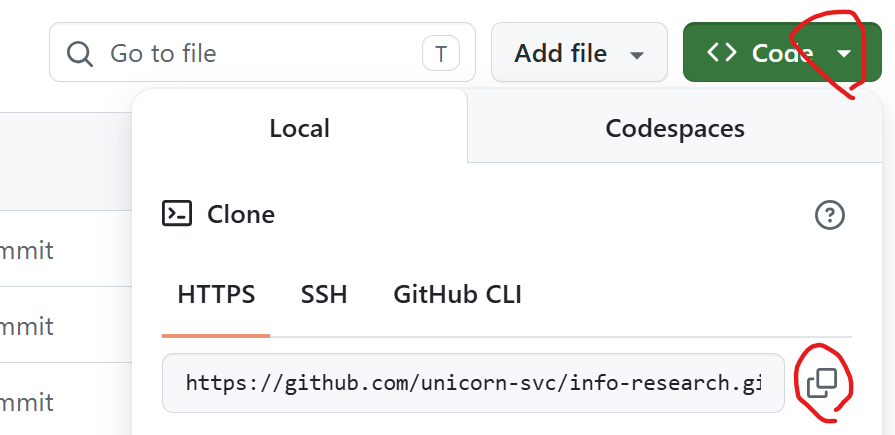

# 10회차 과제 수행 방법 안내
## 사전설치 
- 가이드: https://github.com/unicorn-plugins/npd/blob/main/resources/guides/setup/prepare.md   
※ 반드시 **Docker Desktop 설치**해야함. Window 사용자는 WSL(Window Subsystem for Linux)를 먼저 설치  

---

## 과제 수행 

### API Key 생성
#### Cohere: 임베딩과 리랭킹 모델      
회원 가입 후 Default로 제공되는 기본 API Key 확보    
https://dashboard.cohere.com/api-keys

#### Groq API Key   
Groq: https://console.groq.com/keys

### 사전준비
- 9주차 과제 수행: [링크](./09.guide-homework-09.md)  

- 예제 Repository 클론  
  ```
  cd ~/workspace/temp
  git clone https://github.com/cna-bootcamp/rag
  ``` 
- 예제 Repository에서 본인 프로젝트로 파일 복사   
  | 예제 Repository(temp/rag) | 본인 프로젝트(rag) | 용도 | 비고 | 
  | ------------------------ | ----------------- | ---- | ---- |
  | neo4j | neo4j | Neo4J 서버를 컨테이너로 실행 | 디렉토리 복사 |
  | vectordb | vectordb | 벡터DB | 디렉토리 복사. 9주차 과제 수행했으면 Skip | 
  | graphrag/schema | graphrag/schema | 특허법 스키마 설계 결과 | 디렉토리 복사 | 
  | references | references | 역량질문 설계 가이드 | 디렉토리 복사 |   
  | prompts/graphrag-*.md 파일 3개 | prompts/graphrag-*.md | GraphRAG 스키마설계,인덱싱,검색기 프롬프트 | 파일 복사 |   

- `.env`파일에 Jev AI API Key 추가 
  본인만의 Jev API Key를 사용하려면 아래 링크에서 회원가입 -> 신용카드 정보 추가 -> API Credit 구매.     
  아니면, 아래 API Key 그대로 사용 (약 1달 후 삭제 예정)    
  ```
  ## https://console.typesafe.ai/keys
  JEV_API_KEY=apikey_2138da71ee9b2b054234acb5c23d80db76a9_57705ffecfc93e2c37362942ee3ab359522bce55934e3e752d57b5bbd0fb4655
  
  ## Context7 API Key
  CONTEXT7_API_KEY=ctx7sk-91814046-7fce-412b-92c0-6db13f0302ac
  ``` 
  ※ context7 api key는 API key 없이 무료로 사용할 수 있는 한도 초과 시 사용하기 위함   

- `neo4j/.env` 파일 생성 및 암호 등록. 암호는 아무거나 등록        
  ```
  NEO4J_PASSWORD=neo4j
  ```

- Neo4j 서버를 컨테이너로 실행    
  ```
  cd ~/workspace/rag
  docker compose -f neo4j/compose.yml up -d
  ```

  ※ Neo4j 의 웹UI 접근, 컨테이너 시작/중지/삭제는 `neo4j/README.md` 참조     

### GraphRAG 스키마 설계 (선택)   
스키마 설계부터 실습하고 싶은 분만 수행하세요.     
`graphrag/schema` 디렉토리 삭제 후 프롬프트 `prompts/graphrag-schema.md` 수행    

### GraphRAG 인덱서 개발
`prompts/graphrag-index.md` 수행      
수행 후 graphrag/index/README.md 참조     

### GraphRAG 검색기 개발 
`prompts/graphrag-search.md`에 수행   
수행 후 graphrag/search/README.md 참조  

### 오케스트레이터 검색기 실습: 벡터+키워드+그래프 검색 
아래 프롬프트 내용을 `prompts/search-orchestrator.md`파일에 작성하고 수행    
```
[목표]
질문에 따라 벡터 하이브리드 검색과 그래프 검색을 골라 쓰는 검색 오케스트레이터 예제 개발
- 질문 1건마다 라우팅 → 검색 → RRF 병합 → Cohere 리랭킹 → 답변 생성을 수행함
- 평가셋으로 라우팅 정확도와 4대 지표 위-정-출-관(Context Precision, Context Recall, Faithfulness, Answer Relevance)를 측정해 기록함

[역할]
당신은 벡터 검색, BM25 검색, 그래프 검색(GraphRAG)에 능통한 AI 앱 개발 전문가임

[맥락]
- 특허법 조문을 대상으로 한 RAG 실습 저장소의 다음 단계임. 이전 단계에서 아래 검색기들을 이미 만들고 검증함
  - 벡터 하이브리드 검색(BM25 + 벡터, 가중 RRF): `vector/hybrid-search/hybrid_rag.py`
  - 하이브리드 1차 검색 + Cohere 리랭킹: `vector/re-ranking/rerank_rag.py`
  - 그래프 검색(Jev 라우팅으로 Local / Global / Hybrid 선택): `graphrag/search/graph_search.py`
- 벡터 DB와 그래프는 같은 청크(컬렉션 `patent_law`)에서 만들어짐. 벡터 청크의 `chunk_index`와 그래프 `Chunk.index`는 같은 청크를 가리킴
- 알려진 제약
  - Cohere 트라이얼 키는 분당 10회 제한이 있음(`cohere.errors.TooManyRequestsError`)
  - chromadb는 `vectordb/`를 읽기만 해도 파일을 갱신함. `vectordb/` 변경은 커밋하지 않음
  - Ragas 0.4.x는 langchain-community 0.4.x와 함께 설치하면 import가 실패함(`langchain_community.chat_models.vertexai` 없음)
  - Neo4j 7687 포트를 다른 프로젝트의 같은 이름 컨테이너(`hybrid-ai-neo4j`)가 차지하고 있을 수 있음

[입력]
- 벡터 하이브리드 검색기: `vector/hybrid-search/`
- 벡터 리랭킹: `vector/re-ranking/`
- 그래프 검색기: `graphrag/search/`
- 벡터 DB: `vectordb/`
- BM25 인덱스: `bm25/`
- 그래프 DB: Neo4j 서버(`neo4j/README.md` 참조, 비밀번호는 `neo4j/.env`의 `NEO4J_PASSWORD`)
- API Key: 저장소 루트의 `.env` (`GROQ_API_KEY`, `COHERE_API_KEY`, `JEV_API_KEY`)

[처리]
0) 기존 프로그램 파악
   - 위 3개 검색기의 함수와 설정값을 읽고, 재사용할 함수 목록을 정리함
   - 인덱싱은 새로 하지 않음. 기존 벡터 DB, BM25 인덱스, 그래프 DB를 로드해 검색함

1) 사전 검사: 하나라도 실패하면 안내 문구만 내고 종료함. 키 값과 비밀번호 값은 출력하지 않음
   - 비어 있는 API Key: 키 이름만 안내(GROQ_API_KEY, COHERE_API_KEY, JEV_API_KEY)
   - Neo4j 접속 실패
     - 연결 거부: `neo4j/README.md`의 실행 명령(`docker compose -f neo4j/compose.yml up -d`)을 안내
     - 인증 실패: 다른 프로젝트의 Neo4j 컨테이너가 7687 포트를 쓰고 있을 수 있다고 안내하고, `docker inspect hybrid-ai-neo4j`로 compose 작업 폴더를 확인하라고 안내
   - 그래프 없음: 엔티티(`__Entity__`) 노드, 커뮤니티 요약(`Community.summary`), 벡터 인덱스(`entity_embedding`, `community_embedding`) 중 하나라도 없으면 `prompts/graphrag_index.md`를 먼저 수행하라고 안내
   - 벡터 DB, BM25 인덱스 검사는 `rerank_rag.load_vectorstore`, `load_bm25_retriever`, `check_same_corpus`의 예외를 그대로 안내함
   - Neo4j 검사는 `graph_search.precheck()`를 재사용하고, 위 항목 중 빠진 것만 덧붙임

2) S1. 질문 분석 및 라우팅
   - TypeSafe Jev(`typesafe-sdk`, 모델 `jev-latest`, 재시도 0회)를 1회 호출해 검색 방식을 고름
   - 질문은 `state`에, 선택지 3개는 `Choice`의 `criteria`에 넣음
     - `vector-hybrid`: 특정 조문의 문구, 기간, 요건, 절차를 원문에서 찾아 답하는 질문
     - `graph`: 개념 사이의 관계나 법 전체의 주제와 흐름을 묻는 질문
     - `all`: 특정 조문과 전체 맥락을 함께 봐야 답할 수 있는 질문
   - 응답의 `choice`, `confidence`, `probabilities`를 기록함
   - 호출이 실패하거나 선택지 밖의 값이 오면 `all`로 처리하고 실패 사유(예외 이름)를 기록함

3) S2. 검색: 각 검색은 후보 목록만 만들고, 리랭킹은 S3에서 한 번만 함
   - 벡터 하이브리드: `rerank_rag`의 1차 검색기(`build_ensemble`, BM25 + 벡터, 검색기별 `FETCH_K`개)를 재사용함
   - 그래프: `graph_search.GraphSearch`의 `route()`와 `retrieve()`를 재사용함
     - `route()`가 Local / Global / Hybrid를 고름(그래프 하위 라우팅, Jev 1회 추가 호출). 결과를 S1 결과와 함께 기록함
     - LLM응답 생성인 `ask()`와 `generate()`는 쓰지 않음(답변 LLM은 S4에서 1회만 호출)
   - `all`: 벡터 하이브리드와 그래프 검색을 병렬로 수행함(LCEL `RunnableParallel`)
   - 리랭킹을 위해 검색 결과를 LangChain `Document`로 바꿈. `metadata.source_type`에 출처를 적음
     - 벡터 청크 1개 → Document 1건 (`vector`)
     - Local 엔티티 1개 → Document 1건 (`graph-local`, 본문은 "유형: 이름" + 관계 목록)
     - Local 출처 청크 → 청크 Document (`graph-local-chunk`). 같은 `chunk_index`의 벡터 청크와 겹치면 하나만 남김
     - Global 커뮤니티 요약 1개 → Document 1건 (`graph-global`)
   - 두 검색을 모두 했으면 결과 목록들을 RRF(`score = Σ 1/(rank + 60)`)로 병합함

4) S3. 리랭킹
   - 병합된 후보 전체를 Cohere `rerank-multilingual-v3.0`으로 한 번 리랭킹해 상위 6건을 남김
   - `rerank_rag.build_reranker`와 `rerank_docs`를 재사용함
   - `TooManyRequestsError`가 나면 대기 후 재시도하되, 질문 1건당 최대 3회로 제한함

5) S4. 답변 생성
   - 리랭킹된 컨텍스트와 질문으로 Groq `openai/gpt-oss-120b`를 1회 호출함(LCEL 체인 + `with_structured_output`)
   - 출력 스키마: `answer`(한국어 답), `evidence`(답에 쓴 조문 번호 또는 엔티티 이름 목록)
   - 컨텍스트에 있는 내용만 씀. 컨텍스트로 답할 수 없는 부분은 "컨텍스트에서 확인되지 않음"으로 씀
   - 화면 출력: 질문, 선택된 검색 방식과 확신도, 그래프 하위 검색 방식(그래프를 쓴 경우), 답변, 근거
   - `--verbose`를 주면 리랭킹된 컨텍스트(출처 유형, 리랭킹 점수 포함)도 보여 줌

6) 테스트 및 버그 수정
   - 단위 테스트(pytest, API 호출 없음): Jev 실패 시 `all` 대체, RRF 병합 순서, Document 변환과 청크 중복 제거, 사전 검사 안내 문구
   - 평가셋 작성: 15문항 이상
     - 벡터 하이브리드형 5, 그래프 Local형 5, 그래프 Global형 5. `all`형은 선택(2문항 이내)
     - 문항마다 기대 검색 방식, 참조 답변(조문 근거 포함), 근거 조문 번호를 적음
     - 평가를 돌리기 전에 각 문항을 Jev로 한 번 찍어 본 결과와 함께 평가셋을 나에게 보여 주고 확정받음
   - 평가 실행과 기록
     - 문항별로 선택된 검색 방식, 확신도, 그래프 하위 검색 방식, 답변, 4대 지표를 기록함
     - 4대 지표는 교재의 암기팁 "위-정-출-관"(위에 깔리고, 정답 많이 있고, 출처와 관련도가 높은가?)으로 측정함. 모두 0~1 점수이며 높을수록 좋음
       | 암기 | 지표 | 쉬운 질문 | 채점 방법 |
       |------|------|-----------|-----------|
       | **위** | Context Precision(검색 정밀도) | 질문과 관련된 자료가 검색 결과 **위**쪽에 깔렸나? | 리랭킹된 자료마다 "답에 쓸모 있나?"를 판정하고, 쓸모 있는 자료가 위에 있을수록 높은 점수 |
       | **정** | Context Recall(검색 재현율) | 검색 결과에 **정**답 내용이 많이 들어 있나? | 참조 답변을 문장 단위로 나누고, 검색 자료에서 찾을 수 있는 문장의 비율 |
       | **출** | Faithfulness(근거성) | 답변이 **출**처(검색 자료)에 근거했나? | 생성 답변을 문장 단위로 나누고, 검색 자료로 뒷받침되는 문장의 비율 |
       | **관** | Answer Relevance(답변 적절성) | 답변이 질문과 **관**련 있나? | 답변이 질문에 맞는 답인지 채점 LLM이 0~1로 매김 |
     - 채점은 Groq `openai/gpt-oss-120b`를 채점 LLM으로 쓰는 LCEL + structured output 채점기로 직접 구현함(Ragas 패키지는 설치하지 않음)
     - 보고서에는 지표마다 "암기 글자(위·정·출·관) + 지표 이름"을 함께 적음
     - 결과는 문항마다 즉시 파일에 저장해, 중간에 멈춰도 이어서 실행할 수 있게 함

7) README.md 작성
   - 목표 및 주요 기능
   - 소스 코드 설명: 주요 함수, 처리 흐름(S1~S4 다이어그램), 재사용한 기존 함수 목록
   - 가상환경 설정 및 패키지 설치: Windows(PowerShell, Git Bash), Mac/Linux별로 작성
   - 실행 방법: 단일 질문, `--verbose`, 단위 테스트, 평가 실행
   - 평가 결과 요약과 한계

[출력]
- 프로그램 폴더: `search-orchestrator/`
  - `search_orchestrator.py`: 사전 검사, S1~S4, CLI(`question`, `--verbose`, `--route`로 S1 건너뛰기)
  - `test_search_orchestrator.py`: 단위 테스트
  - `eval_set.json`: 평가셋(확정본)
  - `run_eval.py`: 평가 실행기
  - `eval-report.md`: 평가 결과(문항별 표 + 평균 + 라우팅 일치율 + 실패 사례 분석)
  - `requirements.txt`, `README.md`

[제약조건]
- MUST
  - (중요) requirements.txt의 주석은 영문으로 작성
  - (중요) 벡터 하이브리드 검색, 리랭킹, 그래프 검색은 기존 프로그램의 함수를 import해 재사용함. 같은 기능을 새로 개발하지 않음. 기존 프로그램 파일은 수정하지 않음
  - 추가 정보나 내 의사결정이 필요하면 진행을 멈추고 반드시 나에게 요청
  - LangChain을 기본으로 사용하고, deprecated된 기능은 native 라이브러리로 대체함. 단 그래프 검색(neo4j-graphrag)과 Jev(typesafe-sdk)는 기존 구현 그대로 씀
  - LCEL 체인과 structured output은 S4 답변 생성과 평가 채점기에 적용함
  - 라이브러리 사용법은 context7 MCP로 확인함. 월 한도 초과 시 `.env`의 `CONTEXT7_API_KEY`로 API를 직접 호출함
  - API Key와 Neo4j 비밀번호 값은 화면, 로그, 파일 어디에도 남기지 않음
- MUST NOT
  - 벡터 DB, BM25 인덱스, 그래프를 새로 만들거나 고치지 않음. 그래프가 없으면 사전 검사에서 안내하고 멈춤
  - 다른 프로젝트의 Docker 컨테이너나 볼륨을 멈추거나 지우지 않음
  - `vectordb/` 변경분을 커밋하지 않음
- 완료조건
  - [출력]의 파일이 모두 있음
  - 단위 테스트가 모두 통과함(pytest 출력으로 확인)
  - 확정된 평가셋 전 문항이 오류 없이 실행되고 `eval-report.md`에 기록됨
  - 목표치: 라우팅 일치율 80% 이상, 출(Faithfulness) 평균 0.8 이상, 관(Answer Relevance) 평균 0.8 이상
    - 목표치에 못 미치면 원인 분석을 보고서에 적고 나에게 보고함. 임의로 프롬프트나 설정을 바꿔 맞추지 않음

[예시]
<example>
python search-orchestrator/search_orchestrator.py "특허권의 존속기간은 언제까지인가?"
[질문] 특허권의 존속기간은 언제까지인가?
[검색 방식] vector-hybrid (확신도 0.98)
[답변] 특허권의 존속기간은 설정등록한 날부터 특허출원일 후 20년이 되는 날까지임 ...
[근거] 제88조
</example>
```

---

## 과제 제출 방법 
- 본인 프로젝트 Git Push    
  아래 프롬프트에서 Git Organization 이름을 본인 것으로 변경하여 수행    
  ※ 기존에 플러그인 개발한 Repository와 동일한 Organization으로 지정    
  ```
  Organization {본인 Git Organization}에 Private Repository 'rag'를 생성하고 푸시  
  ```
- [10회차 과제 제출 문서](https://docs.google.com/spreadsheets/d/1poGVLTJYYtur5HSMTjy0iJpoc2MX_Mhn/edit?usp=drive_link&ouid=110516422607493163049&rtpof=true&sd=true)에 Git Repository 주소와 GraphRAG 배운점/느낀점 작성    

> **※ 주의사항**   
> - 구글 드라이브 문서에 고객 정보, 회사 내부 기밀정보 등 **보안 위배/의심 정보 작성 금지**   
> - Git Repository는 반드시 **Private Repository**로 만드십시오.   

---

## 평가 기준     
평가 없음 

---
  
## Appendix 

※ Repository 주소 복사  
  

※ Organization에 권한 부여: [가이드](../references/GitHub멤버등록.md)

